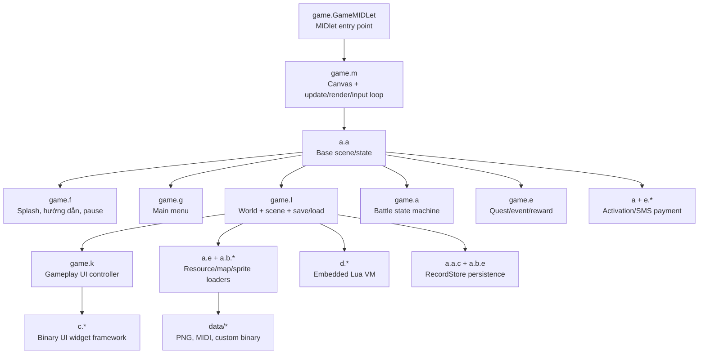

# Kiến trúc game đã suy luận

## Luồng thực thi chính

## Các khối quan trọng

### Khởi động và game loop

`game.GameMIDLet` tạo `Display`, khởi tạo singleton `game.m`, rồi đặt Canvas này làm màn hình hiện tại. `game.m` giữ thread loop, gọi update/paint và chuyển tiếp keypad/pointer input cho scene đang hoạt động.

### Scene/state engine

`a.a` là lớp scene trừu tượng mà nhiều màn hình `game.*` kế thừa. Các lớp ở module `02_scene_input_primitives` cung cấp timer, callback và base object. Do tên đã bị rút gọn, ranh giới cụ thể giữa một số primitive chỉ có độ tin cậy trung bình.

### World và dữ liệu lưu

`game.l` là hub lớn nhất của world runtime: nạp scene/event, quản lý trạng thái người chơi, đọc/ghi nhiều RecordStore có prefix `PK6_RMS_*`, điều phối UI và chuyển battle. Các loader `a.b.c`, `a.b.d`, `a.b.f` đọc database, map/module và sprite binary.

### Chiến đấu và thực thể

`game.a` chứa battle state machine, thứ tự lượt, bắt pet, hiệu ứng, damage và combat rendering. `game.i` biểu diễn pet/combatant với element, stat và skill. `game.h` và `game.j` là các aggregate actor/world gameplay; vai trò chi tiết của chúng được đánh dấu mức `medium` trong class catalog.

### UI

Package `c.*` là widget framework dùng để nạp layout nhị phân `data/ui/*.ui`. `game.k` là controller UI gameplay rất lớn, tham chiếu trực tiếp 41 family/path UI cho túi đồ, shop, pet, task, help, system và dialog.

### Lua runtime

Package `d.*` là một máy ảo Lua nhúng, không phải package SMS như tên obfuscate có thể gợi nhầm. Bằng chứng gồm standard functions `pcall`, `tostring`, `tonumber`, table/stack, loader bytecode và lỗi runtime như `call nil`.

### SMS/payment

Các package `e.a.a.a.*`, `e.b.a.a.*`, class gốc `a` và shim `lavax.wireless.messaging.MessageConnection` triển khai activation/payment bằng Wireless Messaging API. Chúng chứa UI gửi tin, cấu hình số/nội dung/giá và worker gửi SMS.

## Điểm nóng dependency

Theo graph 363 cạnh nội bộ, các hub được tham chiếu nhiều nhất là:

1. `a.e` — utility resource/graphics/data.
2. `a.a` — base scene/state.
3. `game.l` — world orchestration.
4. `a.b.c` — asset database.
5. `a.b.a`, `a.b.g` — primitive/renderer dùng rộng rãi.

Graph đầy đủ nằm ở `class-dependencies.dot`; có thể mở bằng Graphviz hoặc extension DOT trong IDE.
