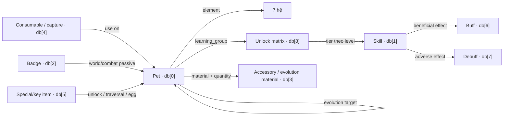

# VQSV Wiki — Pet, Skill & Item UI Knowledge Base

> Tài liệu bàn giao context cho mọi task/chat phát triển giao diện wiki Vương Quốc Sủng Vật (VQSV). Cập nhật từ bản game J2ME `AowVN.org-S60-VuongQuoc-Pokemon-240x320.jar`, không phải dữ liệu do người viết tự đặt.

## 1. Cách dùng tài liệu này

Khi mở một task Codex mới, yêu cầu task đó đọc toàn bộ file này trước khi thiết kế schema, route, API hay giao diện Pet/Skill/Item. Sau đó cho phép nó đọc các nguồn chứng cứ được liên kết ở mục 3 khi cần kiểm tra chi tiết.

Prompt bàn giao ngắn có thể dùng:

```text
Đọc toàn bộ resources/decoded/06_analysis/pet-skill-item-ui-knowledge.md và coi đó là source of truth cho wiki VQSV. Giữ nguyên ID game, tên/dịch gốc và các nhãn confidence. Trước khi code hãy đối chiếu convention hiện tại của Laravel 13 + Inertia React 3 + Tailwind 4; mọi liên kết frontend-backend dùng Wayfinder. Phạm vi đầu tiên chỉ gồm Pet, Skill và Item.
```

## 2. Tóm tắt điều đã xác nhận

- Game có đúng **100 Pet**, ID `0..99`.
- Game có đúng **70 Skill**, ID `0..69`; mỗi hệ có 10 skill.
- Wiki Item nên bao phủ **52 record** thuộc bốn bảng: 8 huy chương, 18 trang sức/nguyên liệu, 15 vật phẩm tiêu hao và 11 vật phẩm đặc thù.
- Có **15 trạng thái có lợi**, **11 trạng thái bất lợi** và 4 ma trận mở khóa skill.
- Có 7 hệ thực chiến: **Hỏa, Mộc, Thổ, Thủy, Điện, Quỷ, Phong**.
- Vòng khắc hệ: `Hỏa → Mộc → Thổ → Thủy → Hỏa` và `Quỷ → Phong → Điện → Quỷ`.
- Pet và Skill nối với nhau qua `pet.element`, `pet.learning_group`, `skill.tier` và bảng mở khóa theo mốc level.
- Pet tiến hóa/dị hóa nối sang Pet khác bằng ID đích và tiêu hao item bảng `db[3]`, ID `12..16`.
- Icon item không phải các file `img_<id>.png` riêng lẻ. Giá trị icon trong DB là **frame index của sprite atlas `spr_258`**. Không được dựng URL PNG giả từ frame ID.
- Pet dùng animation `spr_<sprite_id>_all(r)`; đây là tài nguyên sprite riêng của game, không phải PNG tĩnh đã sẵn sàng dùng trực tiếp trên web.

### Mức độ tin cậy

| Nhãn          | Ý nghĩa                                                                                              |
| ------------- | ---------------------------------------------------------------------------------------------------- |
| Xác nhận      | Có đường đọc/ghi hoặc render trực tiếp trong mã decompile.                                           |
| Suy luận mạnh | Được xác nhận bởi cấu trúc bảng, dữ liệu và nhiều điểm sử dụng, nhưng tên field gốc đã bị obfuscate. |
| Raw           | Giữ nguyên giá trị để tránh gán sai nghĩa; UI nội bộ có thể hiển thị ở chế độ debug.                 |

## 3. Nguồn chứng cứ và quy tắc ưu tiên

1. Nguồn chính: [`02_decompiled/vineflower`](../02_decompiled/vineflower).
2. Nguồn đối chiếu: [`02_decompiled/cfr`](../02_decompiled/cfr) và [`03_bytecode`](../03_bytecode).
3. Dữ liệu gốc: [`01_original/archive/data/script/db.mid`](../01_original/archive/data/script/db.mid) và [`chs.mid`](../01_original/archive/data/script/chs.mid).
4. UI gốc: [`01_original/archive/data/ui`](../01_original/archive/data/ui).
5. Asset đã nhận dạng: [`04_resources/recognized`](../04_resources/recognized).

Game nạp chín ma trận `short[][]` liên tiếp từ `db.mid` tại [`a/b/c.java`](../02_decompiled/vineflower/a/b/c.java), và nạp từ điển 636 chuỗi từ `chs.mid`. Định dạng mỗi ma trận:

```text
big-endian signed short: rowCount
repeat rowCount:
    big-endian signed short: columnCount
    repeat columnCount: big-endian signed short value
```

Mọi cột tên/mô tả đều là string ID, được giải bằng `a.a.c(int)`. Không chỉnh chính tả tên gốc trong trường `name_original`; nếu cần tên hiển thị đã biên tập, thêm trường riêng `name_display`.

## 4. Bản đồ domain



### Chín bảng trong `db.mid`

| Bảng    | Số dòng | Độ rộng | Ý nghĩa                                            |
| ------- | ------: | ------: | -------------------------------------------------- |
| `db[0]` |     100 |      23 | Pet/species.                                       |
| `db[1]` |      70 |      10 | Skill.                                             |
| `db[2]` |       8 |       7 | Huy chương và cấp cường hóa.                       |
| `db[3]` |      18 |     5–7 | Trang sức, nguyên liệu tiến hóa/dị hóa, chìa khóa. |
| `db[4]` |      15 |     6–9 | Cầu phong ấn, hồi phục, hồi sinh, tiện ích.        |
| `db[5]` |      11 |       3 | Vật phẩm đặc thù/nhiệm vụ.                         |
| `db[6]` |      15 |       5 | Trạng thái có lợi.                                 |
| `db[7]` |      11 |       3 | Trạng thái bất lợi.                                |
| `db[8]` |       4 |       5 | Ma trận tier skill theo nhóm học và mốc level.     |

## 5. Pet

### 5.1 Schema đề xuất cho wiki

| Field                                                  | Nguồn              | Confidence                             | Cách dùng UI                                                                                     |
| ------------------------------------------------------ | ------------------ | -------------------------------------- | ------------------------------------------------------------------------------------------------ |
| `game_id`                                              | index dòng `db[0]` | Xác nhận                               | ID ổn định, dùng route/slug fallback.                                                            |
| `name_original`                                        | cột 0 → `chs`      | Xác nhận                               | Tiêu đề Pet.                                                                                     |
| `element_id`                                           | cột 1              | Xác nhận                               | Filter/badge hệ. Mapping đúng theo dữ liệu: 0 Hỏa, 1 Mộc, 2 Thổ, 3 Thủy, 4 Điện, 5 Quỷ, 6 Phong. |
| `variant_code`                                         | cột 2              | Raw                                    | Có tham gia logic tiến hóa/dị hóa; chưa nên gắn nhãn hiển thị cứng.                              |
| `quality_tier`                                         | cột 3              | Suy luận mạnh                          | Hệ số tính stat qua `[90,95,100,110,125]%`; dùng nội bộ cho calculator.                          |
| `rarity_or_growth_code`                                | cột 4              | Raw                                    | Có nhánh đặc biệt khi sinh Pet; chưa đủ bằng chứng để đặt tên rarity.                            |
| `hp_base`, `hp_per_level`, `hp_offset`                 | cột 5–7            | Xác nhận                               | Calculator HP.                                                                                   |
| `stat_2_base`, `stat_2_per_level`, `stat_2_offset`     | cột 8–10           | Xác nhận công thức, tên stat chưa chắc | Calculator.                                                                                      |
| `stat_3_base`, `stat_3_per_10_levels`, `stat_3_offset` | cột 11–13          | Xác nhận công thức, tên stat chưa chắc | Calculator.                                                                                      |
| `stat_4_base`, `stat_4_per_10_levels`, `stat_4_offset` | cột 14–16          | Xác nhận công thức, tên stat chưa chắc | Calculator.                                                                                      |
| `sprite_id`                                            | cột 17             | Xác nhận                               | Tham chiếu `data/spr/spr_<id>_all(r)`.                                                           |
| `learning_group`                                       | cột 18             | Xác nhận                               | 0..3, dùng với `db[8]`.                                                                          |
| `evolves_to_pet_id`                                    | cột 19             | Xác nhận                               | Link Pet → Pet; `-1` là không có nhánh kế tiếp.                                                  |
| `evolution_material_id`                                | cột 20 + 12        | Xác nhận                               | Link đến Item `db[3]`; chỉ hợp lệ khi cột 19 != -1.                                              |
| `evolution_material_qty`                               | cột 21             | Xác nhận                               | Số lượng cần.                                                                                    |
| `effectiveness_class`                                  | cột 22             | Xác nhận giá trị, Raw về nhãn          | Tham gia logic khắc hệ đặc biệt; chưa đặt tên marketing.                                         |

Công thức stat trong game:

```text
qualityMultiplier = [90, 95, 100, 110, 125][qualityTier - 1]

stat1 = (c5  + c6  * level      + c7 ) * qualityMultiplier / 100
stat2 = (c8  + c9  * level      + c10) * qualityMultiplier / 100
stat3 = (c11 + c12 * level / 10 + c13) * qualityMultiplier / 100
stat4 = (c14 + c15 * level / 10 + c16) * qualityMultiplier / 100
```

Lưu ý quan trọng: helper `game.i.U()` chứa mảng nhãn hệ không khớp với skill, tên Pet và thuật toán khắc hệ. Wiki phải dùng mapping `0 Hỏa, 1 Mộc, 2 Thổ, 3 Thủy, 4 Điện, 5 Quỷ, 6 Phong`, vì mapping này đồng thời khớp 70 skill và toàn bộ vòng khắc hệ thực thi.

### 5.2 Catalog 100 Pet

Mỗi mục có dạng `ID · Tên · sprite · nhóm học · tiến hóa/dị hóa`. `—` nghĩa là không có target tiếp theo trong DB.

#### Hỏa — 16 Pet

|  ID | Tên gốc                    | Sprite | Nhóm | Target và nguyên liệu                     |
| --: | -------------------------- | -----: | ---: | ----------------------------------------- |
|   0 | Nhiên Dực Bức              |     86 |    0 | —                                         |
|   1 | Bom tinh nghịch            |     87 |    0 | —                                         |
|   2 | Nhiên Liệp Sư              |     88 |    1 | —                                         |
|   3 | Hắc Thán Báo               |     89 |    1 | —                                         |
|   4 | Hỏa Diễm Hồ                |     90 |    1 | —                                         |
|   5 | Viêm Ma                    |     91 |    3 | —                                         |
|   6 | Long bảo bối               |     92 |    2 | #7 Phệ Hỏa Thú; item db[3]#12 ×1          |
|   7 | Phệ Hỏa Thú                |     93 |    2 | #8 Bạo Long Thú; item #13 ×1              |
|   8 | Bạo Long Thú               |     94 |    3 | —                                         |
|   9 | Ly Ngưu Ngưu               |     95 |    2 | #10 Ly Ngưu Thản Khắc; item #12 ×2        |
|  10 | Ly Ngưu Thản Khắc          |     96 |    1 | —                                         |
|  11 | Nhiệt Bạo Phong Tốc Khuyển |     97 |    2 | #12 Tuyệt Đối Linh Độ Khuyển; item #15 ×1 |
|  12 | Tuyệt Đối Linh Độ Khuyển   |     98 |    3 | —                                         |
|  13 | Hỏa Diễm Tường Vân Khuyển  |     99 |    3 | #14 Tà Vân Khuyển Thần; item #15 ×1       |
|  14 | Tà Vân Khuyển Thần         |    100 |    2 | —                                         |
|  15 | Hỏa Phượng Hoàng           |    101 |    3 | —                                         |

#### Mộc — 16 Pet

|  ID | Tên gốc                  | Sprite | Nhóm | Target và nguyên liệu                     |
| --: | ------------------------ | -----: | ---: | ----------------------------------------- |
|  16 | Diệp Tán Oa              |    102 |    2 | #17 Thụ Tán Oa; item #12 ×2               |
|  17 | Thụ Tán Oa               |    103 |    2 | #18 Long Oa; item #13 ×1                  |
|  18 | Long Oa                  |    104 |    3 | —                                         |
|  19 | Tiên Nhân Cầu Bảo Bảo    |    105 |    3 | #20 Tiên Nhân Chưởng Thú; item #12 ×2     |
|  20 | Tiên Nhân Chưởng Thú     |    106 |    1 | #21 Thiết Tý Phách Vương Thụ; item #13 ×1 |
|  21 | Thiết Tý Phách Vương Thụ |    107 |    1 | —                                         |
|  22 | Khẩu Đại Thảo            |    108 |    0 | —                                         |
|  23 | Khốc Tị Mộc Linh         |    109 |    1 | —                                         |
|  24 | La Phục Thảo             |    110 |    0 | #25 La phục Oa Oa; item #12 ×1            |
|  25 | La phục Oa Oa            |    111 |    1 | —                                         |
|  26 | Tây Quan Tiểu Hương Trư  |    112 |    1 | #27 Trư Lộc Điệp; item #12 ×1             |
|  27 | Trư Lộc Điệp             |    113 |    2 | —                                         |
|  28 | Cương Tán Ma Cô          |    114 |    2 | —                                         |
|  29 | Uy Qua Đệ Đệ             |    115 |    1 | —                                         |
|  30 | Thảo Diệp Cô             |    116 |    3 | —                                         |
|  31 | Linh Quang Lộc           |    117 |    3 | —                                         |

#### Thổ — 16 Pet

|  ID | Tên gốc               | Sprite | Nhóm | Target và nguyên liệu                 |
| --: | --------------------- | -----: | ---: | ------------------------------------- |
|  32 | Kim Chỉ Ốc            |    118 |    2 | —                                     |
|  33 | Mèo YeDoon            |    119 |    2 | —                                     |
|  34 | Thỏ Di Lặc Bunny      |    120 |    2 | —                                     |
|  35 | Toản Địa Khâu Dẫn     |    121 |    0 | #36 Toái nham Khâu Dẫn; item #12 ×2   |
|  36 | Toái nham Khâu Dẫn    |    122 |    1 | —                                     |
|  37 | Nham Nham Quy         |    123 |    0 | #38 Kiếm Giáp Hạn Quy; item #12 ×2    |
|  38 | Kiếm Giáp Hạn Quy     |    124 |    2 | —                                     |
|  39 | Bạch Châm Bảo Bảo     |    125 |    3 | #40 Hắc Châm Yển Bảo Bảo; item #15 ×1 |
|  40 | Hắc Châm Yển Bảo Bảo  |    126 |    3 | —                                     |
|  41 | Nham Sơn Long         |    127 |    2 | #42 Zombie Nham Sơn Long; item #15 ×1 |
|  42 | Zombie Nham Sơn Long  |    128 |    2 | —                                     |
|  43 | Thổ Lang Chu Chu      |    129 |    1 | #44 Độc Lang Chu; item #12 ×2         |
|  44 | Độc Lang Chu          |    130 |    1 | —                                     |
|  45 | Sừng tê giác bạo long |    131 |    2 | #46 Khủng giác bạo long; item #15 ×1  |
|  46 | Khủng giác bạo long   |    132 |    3 | —                                     |
|  47 | Chiến Thần Đà         |    133 |    3 | —                                     |

#### Thủy — 16 Pet

|  ID | Tên gốc                | Sprite | Nhóm | Target và nguyên liệu                  |
| --: | ---------------------- | -----: | ---: | -------------------------------------- |
|  48 | Tuyết Cầu Bảo Bảo      |    134 |    2 | #49 Người tuyết; item #12 ×1           |
|  49 | Người tuyết            |    135 |    2 | #50 Tuyết Sơn Cự Linh; item #13 ×1     |
|  50 | Tuyết Sơn Cự Linh      |    136 |    2 | —                                      |
|  51 | Thủy thủ chim cánh cụt |    137 |    2 | #52 Bá tước chim cánh cụt; item #12 ×1 |
|  52 | Bá tước chim cánh cụt  |    138 |    2 | #53 Võ thần chim cánh cụt; item #14 ×1 |
|  53 | Võ thần chim cánh cụt  |    139 |    3 | —                                      |
|  54 | Lục Hành Điểu          |    140 |    0 | —                                      |
|  55 | Cá Miệng Rộng          |    141 |    1 | —                                      |
|  56 | Mực Ma                 |    142 |    0 | —                                      |
|  57 | Cá Đèn Lồng            |    143 |    1 | —                                      |
|  58 | Thủy Thượng Phiêu      |    144 |    3 | —                                      |
|  59 | Phi Thứ Hải Mã         |    145 |    1 | —                                      |
|  60 | Tấn Cá Kiếm            |    146 |    3 | #61 Cốt Cá Kiếm; item #15 ×1           |
|  61 | Cốt Cá Kiếm            |    147 |    2 | —                                      |
|  62 | Độc Giác Kim Ngư       |    148 |    1 | —                                      |
|  63 | Tương Quân Giải        |    149 |    3 | —                                      |

#### Điện — 12 Pet

|  ID | Tên gốc          | Sprite | Nhóm | Target và nguyên liệu            |
| --: | ---------------- | -----: | ---: | -------------------------------- |
|  64 | Lôi Quang Hầu    |    150 |    3 | —                                |
|  65 | Lôi Vân Miêu     |    151 |    1 | #66 Điện Nhãn Miêu; item #12 ×2  |
|  66 | Điện Nhãn Miêu   |    152 |    2 | #67 Thân Sĩ Miêu; item #13 ×1    |
|  67 | Thân Sĩ Miêu     |    153 |    1 | —                                |
|  68 | Điện Miêu        |    154 |    2 | #69 Thiểm Điện Miêu; item #12 ×1 |
|  69 | Thiểm Điện Miêu  |    155 |    3 | —                                |
|  70 | Phù Du Điện Long |    156 |    1 | #71 Phù Du Quỷ Long; item #15 ×1 |
|  71 | Phù Du Quỷ Long  |    157 |    2 | —                                |
|  72 | Chuột Điện       |    158 |    0 | #73 Chuột Lôi Điện; item #15 ×1  |
|  73 | Chuột Lôi Điện   |    159 |    2 | —                                |
|  74 | Dị Tiểu Hiệp     |    160 |    0 | —                                |
|  75 | Lôi Kỳ Lân       |    161 |    3 | —                                |

#### Quỷ — 12 Pet

|  ID | Tên gốc            | Sprite | Nhóm | Target và nguyên liệu               |
| --: | ------------------ | -----: | ---: | ----------------------------------- |
|  76 | Độc Ba Lợi         |    162 |    2 | #77 Kịch Độc Quái; item #12 ×1      |
|  77 | Kịch Độc Quái      |    163 |    2 | #78 Kịch Độc Khủng Thú; item #12 ×1 |
|  78 | Kịch Độc Khủng Thú |    164 |    2 | —                                   |
|  79 | Đan nhãn thú       |    165 |    2 | #80 Độc nhãn quái; item #12 ×1      |
|  80 | Độc nhãn quái      |    166 |    2 | #81 Độc nhãn cự thần; item #13 ×1   |
|  81 | Độc nhãn cự thần   |    167 |    2 | —                                   |
|  82 | Túi quỷ            |    168 |    0 | #83 Thi Đại Quỷ; item #15 ×1        |
|  83 | Thi Đại Quỷ        |    169 |    1 | —                                   |
|  84 | Kính ma            |    170 |    3 | #85 Phá kính tà linh; item #16 ×1   |
|  85 | Phá kính tà linh   |    171 |    3 | —                                   |
|  86 | Hư không hành giả  |    172 |    1 | —                                   |
|  87 | Minh vương Long    |    173 |    3 | —                                   |

#### Phong — 12 Pet

|  ID | Tên gốc              | Sprite | Nhóm | Target và nguyên liệu           |
| --: | -------------------- | -----: | ---: | ------------------------------- |
|  88 | Lắc lắc              |    174 |    0 | —                               |
|  89 | Chim xanh            |    175 |    0 | #90 Tai tước; item #15 ×1       |
|  90 | Tai tước             |    176 |    2 | —                               |
|  91 | Hải âu               |    177 |    0 | #92 Dực thần; item #12 ×2       |
|  92 | Dực thần             |    178 |    1 | —                               |
|  93 | Hồng nhạn            |    179 |    1 | #94 Phi Dực Thú; item #15 ×1    |
|  94 | Phi Dực Thú          |    180 |    3 | —                               |
|  95 | Đậu ưng              |    181 |    0 | #96 Liệt ưng; item #12 ×2       |
|  96 | Liệt ưng             |    182 |    2 | —                               |
|  97 | Quáng thạch dực long |    183 |    3 | #98 Tà ma dực long; item #15 ×1 |
|  98 | Tà ma dực long       |    184 |    2 | —                               |
|  99 | Tinh Vân Hạc         |    185 |    3 | —                               |

## 6. Skill

### 6.1 Schema và quy tắc học skill

| Field                  | Nguồn         | Ý nghĩa                                                                                  |
| ---------------------- | ------------- | ---------------------------------------------------------------------------------------- |
| `game_id`              | index `db[1]` | ID `0..69`.                                                                              |
| `element_id`           | cột 0         | Cứ 10 skill là một hệ; mapping giống Pet.                                                |
| `name_original`        | cột 1 → `chs` | Tên skill.                                                                               |
| `description_original` | cột 2 → `chs` | Mô tả nguyên văn trong game.                                                             |
| `power_percent`        | cột 3         | Hệ số sát thương; `0` thường là skill trạng thái.                                        |
| `tier`                 | cột 4         | Bậc mở khóa `0..3`.                                                                      |
| `max_uses`             | cột 5         | PP/lượt dùng tối đa, game hiển thị `current/max`.                                        |
| `effect_mode`          | cột 6         | `0` không gắn status, `1` trạng thái có lợi (`db[6]`), `2` trạng thái bất lợi (`db[7]`). |
| `effect_id`            | cột 7         | ID status; `-1` nếu không dùng.                                                          |
| `effect_parameter`     | cột 8         | %/magnitude/special parameter tùy skill. Không gán một đơn vị chung.                     |
| `target_side`          | cột 9         | `0` xử lý trên đối thủ, `1` xử lý trên bản thân.                                         |

Mốc level được code cố định là `5, 10, 20, 30, 40`. Giá trị tier tối đa tại mỗi mốc:

| Nhóm học Pet | Lv5 | Lv10 | Lv20 | Lv30 | Lv40 |
| -----------: | --: | ---: | ---: | ---: | ---: |
|            0 |   0 |    0 |    0 |    1 |    1 |
|            1 |   0 |    0 |    1 |    1 |    2 |
|            2 |   0 |    0 |    1 |    2 |    3 |
|            3 |   0 |    1 |    2 |    3 |    3 |

Mỗi Pet học skill trong dải `element_id * 10 .. element_id * 10 + 9`. Pet mới tối đa có 5 slot skill; skill đầu hệ được cấp ở level thấp, các skill còn lại được chọn từ tập đã mở khóa và chưa học.

### 6.2 Catalog 70 Skill

Trong cột Hiệu ứng, `+` tham chiếu `db[6]`, `−` tham chiếu `db[7]`, `—` là không gắn status chuẩn. `P` là cột tham số raw.

#### Hỏa

|  ID | Tên                 | Power | Tier |  PP | Hiệu ứng · P   | Target   | Mô tả gốc                                                                                                               |
| --: | ------------------- | ----: | ---: | --: | -------------- | -------- | ----------------------------------------------------------------------------------------------------------------------- |
|   0 | Hỏa trảo            |   100 |    0 |  45 | — · -1         | Đối thủ  | Thương tổn thấp.                                                                                                        |
|   1 | Dương viêm          |    50 |    0 |  45 | − Gieo Hạt · 4 | Đối thủ  | Thương tổn thấp tăng thêm hiệu quả đốt cháy, mỗi hiệp sẽ giảm bớt trị số sinh mạng nhất định, duy trì liên tục 3 hiệp.  |
|   2 | Diễm kích           |   100 |    0 |  45 | − Mê Muội · 10 | Đối thủ  | Thương tổn thấp, cũng có 10% xác suất lâm vào trạng thái Mê Muội 2 hiệp.                                                |
|   3 | Hỏa Vân triệu       |   100 |    1 |  30 | — · 120        | Đối thủ  | Thương tổn thấp, nếu đối phương đang cháy thì sẽ gia tăng được thương tổn trên người đối phương.                        |
|   4 | Thiên Hỏa tế        |     0 |    1 |  10 | + Súc Lực · -1 | Bản thân | Tăng khả năng phòng ngự 30%, vòng chiến đấu tiếp theo sẽ gia tăng thương tổn.                                           |
|   5 | Viêm lôi phá        |     0 |    1 |  10 | + Phá Phủ · -1 | Bản thân | Khả năng phòng ngự giảm xuống 50%, gia tăng tỷ lệ thương tổn 50%, duy trì liên tục 3 hiệp.                              |
|   6 | Hỏa diễm đao        |   150 |    2 |  30 | — · -1         | Đối thủ  | Tỷ lệ thương tổn gia tăng khá cao.                                                                                      |
|   7 | Chước nhiệt chi xúc |    75 |    2 |  30 | − Gieo Hạt · 3 | Đối thủ  | Thương tổn thấp làm tăng hiệu quả đốt cháy, mỗi hiệp giảm bớt được trị số sinh mạng nhất định, duy trì liên tục 3 hiệp. |
|   8 | Liệt diễm phong bạo |   200 |    3 |  15 | − Mê Muội · 20 | Đối thủ  | Thương tổn cao, cũng có 20% xác suất lâm vào trạng thái Mê Muội 2 hiệp.                                                 |
|   9 | Vĩnh hằng hỏa ảnh   |   200 |    3 |  15 | — · 250        | Đối thủ  | Thương tổn cao, nếu kẻ địch đang cháy thì tỷ lệ thương tổn trên người sẽ gia tăng.                                      |

#### Mộc

|  ID | Tên                  | Power | Tier |  PP | Hiệu ứng · P      | Target   | Mô tả gốc                                                                                             |
| --: | -------------------- | ----: | ---: | --: | ----------------- | -------- | ----------------------------------------------------------------------------------------------------- |
|  10 | Diệp Toàn            |   100 |    0 |  45 | — · -1            | Đối thủ  | Thương tổn thấp.                                                                                      |
|  11 | Quang phản           |    90 |    0 |  45 | — · 10            | Đối thủ  | Thương tổn thấp, có thể khôi phục trị số sinh mạng nhất định.                                         |
|  12 | Đằng Phược           |    50 |    0 |  45 | − Quấn Quanh · -1 | Đối thủ  | Thương tổn thấp, cũng đem Quấn Quanh 3 hiệp.                                                          |
|  13 | Thảo Chủng           |    50 |    1 |  30 | − Thực Loại · 150 | Đối thủ  | Thương tổn thấp, kẻ địch rơi vào trạng thái Thực Loại, sau 2 hiệp tạo thành thương tổn tương đối cao. |
|  14 | Đằng chi bích lũy    |     0 |    1 |  10 | + Kinh Cức · -1   | Bản thân | Gia tăng khả năng phòng ngự 30%, thương tổn cũng dội ngược trở lại, duy trì liên tục 3 hiệp.          |
|  15 | Thảo nguyện thuật    |     0 |    1 |  10 | + Khôi phục · -1  | Bản thân | Mỗi hiệp khôi phục trị số sinh mạng nhất định, duy trì liên tục 3 hiệp.                               |
|  16 | Châm Diệp Trảm       |   150 |    2 |  30 | — · -1            | Đối thủ  | Thương tổn tương đối cao.                                                                             |
|  17 | Diệp chi ân huệ      |   130 |    2 |  30 | — · 40            | Đối thủ  | Thương tổn ở mức độ trung bình, cũng có thể khôi phục trị số sinh mạng nhất định.                     |
|  18 | Đằng mạn triền nhiễu |   150 |    3 |  15 | − Quấn Quanh · -1 | Đối thủ  | Thương tổn tương đối cao, cũng đem Quấn Quanh 3 hiệp.                                                 |
|  19 | Quang hợp hiệu ứng   |   150 |    3 |  15 | − Thực Loại · 200 | Đối thủ  | Thương tổn tương đối cao, kẻ địch rơi vào trạng thái Thực Loại, sau 2 hiệp tạo thành thương tổn cao.  |

#### Thổ

|  ID | Tên                   | Power | Tier |  PP | Hiệu ứng · P     | Target   | Mô tả gốc                                                                                                              |
| --: | --------------------- | ----: | ---: | --: | ---------------- | -------- | ---------------------------------------------------------------------------------------------------------------------- |
|  20 | Hất bụi               |   100 |    0 |  45 | — · -1           | Đối thủ  | Thương tổn thấp.                                                                                                       |
|  21 | Thổ thuẫn             |    80 |    0 |  45 | + Phòng ngự · 10 | Đối thủ  | Thương tổn thấp, có khả năng tự gia tăng phòng ngự 10% (có thể chất chồng).                                            |
|  22 | Bão cát               |    50 |    0 |  45 | − Mê Muội · 25   | Đối thủ  | Thương tổn thấp cũng có 25% xác suất lâm vào trạng thái Mê Muội 2 hiệp.                                                |
|  23 | Nham băng             |   100 |    1 |  30 | — · 250          | Đối thủ  | Thương tổn thấp, kẻ địch rơi vào trạng thái Mê Muội, tạo thành thương tổn cực lớn.                                     |
|  24 | Người bảo vệ Địa Giới |     0 |    1 |  10 | + Thạch Hóa · -1 | Bản thân | Giải phóng những vùng có trạng thái dị thường, mỗi hiệp khôi phục trị số sinh mạng nhất định, duy trì liên tục 3 hiệp. |
|  25 | Thạch phu thuật       |     0 |    1 |  10 | + Thạch Phu · -1 | Bản thân | Giải phóng những vùng có trạng thái dị thường, 3 hiệp có khả năng miễn dịch ở những nơi có trạng thái dị thường.       |
|  26 | Nham bạo              |   150 |    2 |  30 | — · -1           | Đối thủ  | Thương tổn ở mức độ trung bình.                                                                                        |
|  27 | Hàng rào cát đá       |   100 |    2 |  30 | + Phòng ngự · 10 | Đối thủ  | Thương tổn thấp, khả năng tự gia tăng phòng ngự 10% (có thể chất chồng).                                               |
|  28 | Bão cát               |   150 |    3 |  15 | − Mê Muội · 25   | Đối thủ  | Thương tổn ở mức độ trung bình, cũng có 25% xác suất lâm vào trạng thái Mê Muội 2 hiệp.                                |
|  29 | Thổ Chi Loạn Vũ       |   180 |    3 |  15 | — · 300          | Đối thủ  | Thương tổn tương đối cao, kẻ địch rơi vào trạng thái Mê Muội, gia tăng tỷ lệ thương tổn.                               |

#### Thủy

|  ID | Tên                 | Power | Tier |  PP | Hiệu ứng · P     | Target   | Mô tả gốc                                                                                                  |
| --: | ------------------- | ----: | ---: | --: | ---------------- | -------- | ---------------------------------------------------------------------------------------------------------- |
|  30 | Bong bóng           |   100 |    0 |  45 | — · -1           | Đối thủ  | Thương tổn thấp.                                                                                           |
|  31 | Băng lao            |    60 |    0 |  45 | − Mục · 1        | Đối thủ  | Thương tổn thấp cũng làm giảm tỉ lệ đánh trúng mục tiêu, duy trì liên tục 3 hiệp.                          |
|  32 | Tuyết ảnh           |    60 |    0 |  45 | − Chậm Chạp · 10 | Đối thủ  | Thương tổn thấp cũng làm giảm hiệu quả công kích kẻ địch 10% Linh Xảo, duy trì liên tục 3 hiệp.            |
|  33 | Thủy trụ            |   100 |    1 |  30 | − Nhụt Chí · 10  | Đối thủ  | Thương tổn thấp cũng làm giảm hiệu quả công kích kẻ địch 10% thương tổn, duy trì liên tục 3 hiệp.          |
|  34 | Thuật cầu nguyện    |     0 |    1 |  10 | + Vô hình · -1   | Bản thân | 30% xác suất bắn ngược thương tổn, duy trì liên tục 3 hiệp.                                                |
|  35 | Thủy bích           |     0 |    1 |  10 | + Kiên nhẫn · -1 | Bản thân | 50% xác suất gây thương tổn cho kẻ địch bị giảm phân nửa, duy trì liên tục 3 hiệp.                         |
|  36 | Bạo Phong Tuyết     |   150 |    2 |  30 | — · -1           | Đối thủ  | Thương tổn tương đối cao.                                                                                  |
|  37 | Lá chắn gió tuyết   |   100 |    2 |  30 | − Mục · 2        | Đối thủ  | Thương tổn thấp cũng làm giảm tỉ lệ đánh trúng mục tiêu, duy trì liên tục 3 hiệp.                          |
|  38 | Băng Phong Hãm Tịnh |   150 |    3 |  15 | − Chậm Chạp · 10 | Đối thủ  | Thương tổn tương đối cao cũng làm giảm hiệu quả công kích kẻ địch 10% Linh Xảo, duy trì liên tục 3 hiệp.   |
|  39 | Ray lạnh            |   150 |    3 |  15 | − Nhụt Chí · 10  | Đối thủ  | Thương tổn tương đối cao cũng làm giảm hiệu quả công kích kẻ địch 10% thương tổn, duy trì liên tục 3 hiệp. |

#### Điện

|  ID | Tên                  | Power | Tier |  PP | Hiệu ứng · P     | Target   | Mô tả gốc                                                                                     |
| --: | -------------------- | ----: | ---: | --: | ---------------- | -------- | --------------------------------------------------------------------------------------------- |
|  40 | Điện giật            |   100 |    0 |  45 | — · -1           | Đối thủ  | Thương tổn thấp.                                                                              |
|  41 | Lôi thiểm            |    90 |    0 |  45 | − Tê Liệt · 10   | Đối thủ  | Thương tổn thấp cũng làm giảm 10% xác suất làm kẻ địch Tê Liệt 3 hiệp.                        |
|  42 | Nạp điện             |    90 |    0 |  45 | + Linh Xảo · 5   | Đối thủ  | Thương tổn thấp, khả năng tự Linh Xảo gia tăng 5%.                                            |
|  43 | Sóng điện từ         |   100 |    1 |  30 | — · -1           | Đối thủ  | Thương tổn thấp cũng có thể làm giảm mặt lợi ích của bản thân đối với kẻ địch.                |
|  44 | Đoạt mệnh cao áp     |     0 |    1 |  10 | + Điện áp · -1   | Bản thân | Số lần tiêu hao kỹ năng tăng gấp bội, gia tăng tỷ lệ thương tổn 30%, duy trì liên tục 3 hiệp. |
|  45 | Điện năng chuyển đổi |     0 |    1 |  10 | + Hỏa Thạch · -1 | Bản thân | Linh Xảo gia tăng 50%, phòng ngự giảm xuống 50%, duy trì liên tục 3 hiệp.                     |
|  46 | Tia lửa điện         |   150 |    2 |  30 | — · -1           | Đối thủ  | Thương tổn tương đối cao.                                                                     |
|  47 | Chùm sấm sét         |   130 |    2 |  30 | − Tê Liệt · 10   | Đối thủ  | Thương tổn ở mức độ trung bình cũng giảm 10% xác suất làm kẻ địch Tê Liệt 3 hiệp.             |
|  48 | Điện quang thạch hỏa |   130 |    3 |  15 | + Linh Xảo · 5   | Đối thủ  | Thương tổn ở mức độ trung bình, Linh Xảo gia tăng 5%.                                         |
|  49 | Cảm ứng điện từ      |   180 |    3 |  15 | — · -1           | Đối thủ  | Thương tổn cao cũng có thể làm giảm mặt lợi ích của bản thân đối với kẻ địch.                 |

#### Quỷ

|  ID | Tên                  | Power | Tier |  PP | Hiệu ứng · P     | Target  | Mô tả gốc                                                                                                       |
| --: | -------------------- | ----: | ---: | --: | ---------------- | ------- | --------------------------------------------------------------------------------------------------------------- |
|  50 | Ảnh thứ              |   100 |    0 |  45 | — · -1           | Đối thủ | Thương tổn thấp.                                                                                                |
|  51 | Chú oán              |    80 |    0 |  45 | − Phòng Ngự · 20 | Đối thủ | Thương tổn thấp cũng làm giảm hiệu quả công kích kẻ địch 20% phòng ngự, duy trì liên tục 3 hiệp.                |
|  52 | Quỷ độc              |    80 |    0 |  45 | — · 5            | Đối thủ | Thương tổn thấp cũng có một ít xác suất khôi phục giá trị sinh mệnh.                                            |
|  53 | Cơn ác mộng          |   200 |    1 |  30 | — · 200          | Đối thủ | Thương tổn nhất định, giá trị sinh mệnh kẻ địch càng thấp càng thương tổn cao.                                  |
|  54 | Mị ảnh               |     0 |    1 |  10 | − Quỷ Mị · 40    | Đối thủ | 40% xác suất lực công kích của kẻ địch bị dội ngược trở lại, duy trì liên tục 4 hiệp.                           |
|  55 | Hỗn loạn             |     0 |    1 |  10 | − Hỗn Loạn · -1  | Đối thủ | Không bị khống chế, có thể tự do hành động.                                                                     |
|  56 | Độc ảnh thứ          |   150 |    2 |  30 | — · -1           | Đối thủ | Thương tổn tương đối cao.                                                                                       |
|  57 | Chú Phược Quỷ Lao    |   120 |    2 |  30 | − Phòng Ngự · 20 | Đối thủ | Thương tổn ở mức độ trung bình cũng làm giảm hiệu quả công kích kẻ địch 20% phòng ngự, duy trì liên tục 3 hiệp. |
|  58 | Quỷ độc tín ngưỡng   |   100 |    3 |  15 | — · 8            | Đối thủ | Thương tổn thấp cũng có một ít xác suất khôi phục giá trị sinh mệnh.                                            |
|  59 | Lời nguyền cuối cùng |   250 |    3 |  15 | — · 250          | Đối thủ | Giá trị sinh mạng của kẻ địch càng thấp, thương tổn càng cao.                                                   |

#### Phong

|  ID | Tên                 | Power | Tier |  PP | Hiệu ứng · P    | Target   | Mô tả gốc                                                                                                       |
| --: | ------------------- | ----: | ---: | --: | --------------- | -------- | --------------------------------------------------------------------------------------------------------------- |
|  60 | Phong nhận          |   100 |    0 |  45 | — · -1          | Đối thủ  | Thương tổn thấp.                                                                                                |
|  61 | Phong áp            |    80 |    0 |  45 | − Chậm Chạp · 5 | Đối thủ  | Thương tổn thấp cũng làm giảm hiệu quả công kích kẻ địch 5% Linh Xảo, duy trì liên tục 3 hiệp.                  |
|  62 | Thuận phong         |    80 |    0 |  45 | + Man Lực · 5   | Đối thủ  | Thương tổn thấp, lực lượng tự gia tăng 5%, duy trì liên tục 2 hiệp.                                             |
|  63 | Long quyển          |   100 |    1 |  30 | — · 5           | Đối thủ  | Thương tổn thấp, có 5% xác suất tiếp tục công kích lần nữa.                                                     |
|  64 | Nghịch Phong Đoạt   |     0 |    1 |  10 | + Thâu Thủ · -1 | Đối thủ  | Dùng Thâu Thủ để lấy tất cả trạng thái có lợi của kẻ địch sang mình, duy trì liên tục 3 hiệp.                   |
|  65 | Vũ Liệt Thuật       |     0 |    1 |  10 | + Gia Tốc · -1  | Bản thân | Mỗi hiệp công kích hai lần, duy trì liên tục 2 hiệp.                                                            |
|  66 | Yến Hồi Thiểm       |   150 |    2 |  30 | — · -1          | Đối thủ  | Thương tổn tương đối cao.                                                                                       |
|  67 | Phong Chi Tuyền Qua |   110 |    2 |  30 | − Chậm Chạp · 5 | Đối thủ  | Thương tổn ở mức độ trung bình cũng làm giảm hiệu quả công kích kẻ địch 5% nhanh nhẹn, duy trì liên tục 3 hiệp. |
|  68 | Phong Chi Tí Hữu    |   110 |    3 |  15 | + Man Lực · 5   | Đối thủ  | Thương tổn ở mức độ trung bình, lực lượng tự gia tăng 55, duy trì liên tục 2 hiệp.                              |
|  69 | Phi Yến Hoàn Sào    |   150 |    3 |  15 | — · 8           | Đối thủ  | Thương tổn tương đối cao, có 8% xác suất tiếp tục công kích lần nữa.                                            |

### 6.3 Trạng thái liên quan đến Skill

#### Có lợi — `db[6]`

|  ID | Tên       | Thời lượng mặc định | Tham số A | Tham số B |
| --: | --------- | ------------------: | --------: | --------: |
|   0 | Súc Lực   |                   2 |        30 |       190 |
|   1 | Phá Phủ   |                   3 |        50 |        50 |
|   2 | Kinh Cức  |                   3 |        30 |        10 |
|   3 | Khôi phục |                   3 |         5 |        -1 |
|   4 | Phòng ngự |                   2 |        -1 |        -1 |
|   5 | Vô hình   |                   3 |        30 |        -1 |
|   6 | Kiên nhẫn |                   3 |        50 |        -1 |
|   7 | Linh Xảo  |                   2 |        -1 |        -1 |
|   8 | Điện áp   |                   4 |        30 |        -1 |
|   9 | Hỏa Thạch |                   3 |        50 |        50 |
|  10 | Man Lực   |                   2 |        -1 |        -1 |
|  11 | Thâu Thủ  |                   3 |        -1 |        -1 |
|  12 | Gia Tốc   |                   2 |        -1 |        -1 |
|  13 | Thạch Hóa |                   3 |        20 |        -1 |
|  14 | Thạch Phu |                   3 |        -1 |        -1 |

#### Bất lợi — `db[7]`

|  ID | Tên        | Thời lượng mặc định |
| --: | ---------- | ------------------: |
|   0 | Gieo Hạt   |                   3 |
|   1 | Mê Muội    |                   2 |
|   2 | Quấn Quanh |                   3 |
|   3 | Thực Loại  |                   3 |
|   4 | Mục        |                   3 |
|   5 | Chậm Chạp  |                   3 |
|   6 | Nhụt Chí   |                   3 |
|   7 | Phòng Ngự  |                   3 |
|   8 | Quỷ Mị     |                   4 |
|   9 | Hỗn Loạn   |                   1 |
|  10 | Tê Liệt    |                   4 |

## 7. Item

### 7.1 Phân loại dùng cho wiki

Không gộp ID giữa các bảng. Khóa định danh bền vững phải là `(table_id, game_id)`, ví dụ `item-4-6` cho Năng lượng Thạch.

| Nhóm wiki               | Bảng | Số lượng | Mục đích                                                           |
| ----------------------- | ---: | -------: | ------------------------------------------------------------------ |
| Huy chương              |    2 |        8 | Mở traversal/passive và cường hóa.                                 |
| Trang sức               |    3 |       12 | Pet mang theo, tạo passive chiến đấu/EXP/bắt Pet.                  |
| Nguyên liệu & chìa khóa |    3 |        6 | Tiến hóa, dị hóa, mở rương.                                        |
| Cầu phong ấn            |    4 |        4 | Bắt Pet với hệ số khác nhau.                                       |
| Hồi phục/hồi sinh       |    4 |        9 | HP, PP, giải trạng thái, hồi sinh.                                 |
| Tiện ích                |    4 |        2 | Tránh gặp địch, tăng tốc ấp trứng.                                 |
| Đặc thù/nhiệm vụ        |    5 |       11 | Trứng, thú cưỡi, đồ giám, huy hiệu, chỉnh thuộc tính, truyền tống. |

Đối với `db[3]`, `db[4]`, `db[5]`: cột 0 là name string ID, cột 1 là frame trong `spr_258`, cột 2 là description string ID. `db[4]` có thêm giá trị giá/cost ở cột 3, currency/category code ở cột 4, effect type ở cột 5 và tham số biến độ dài từ cột 6.

### 7.2 Huy chương — `db[2]`

Huy chương dùng một màn hình riêng (`badge.ui`). Cột 2 là mô tả cấp 0; cột 3 là mô tả sau cường hóa; cột 4 là điều kiện đạt; cột 5–6 là raw effect parameters.

|  ID | Tên              | Mô tả cấp 0                                         | Mô tả cường hóa                                                 | Điều kiện             | Raw       |
| --: | ---------------- | --------------------------------------------------- | --------------------------------------------------------------- | --------------------- | --------- |
|   0 | Liệt Hỏa Chương  | Gia tăng tầm nhìn trong bóng tối.                   | Sau khi chiến đấu chỉ số sinh mạng sẽ được khôi phục nhất định. | Đạo tràng đạt được.   | `10`      |
|   1 | Mộc Quỳ Chương   | Có khả năng loại bỏ cây cối chướng ngại trên đường. | Gia tăng thuộc tính của rừng cây.                               | Đạo tràng đạt được.   | `5`       |
|   2 | Đại Địa Chương   | Có khả năng phá tan đá chướng ngại.                 | Gia tăng thuộc tính khu nham thạch.                             | Đạo tràng đạt được.   | `5`       |
|   3 | Thủy Lam Chương  | Có thể đi vào vùng thủy vực.                        | Gia tăng thuộc tính của thủy vực.                               | Đạo tràng đạt được.   | `2`       |
|   4 | Hòa Phong Chương | Gia tăng khả năng phòng ngự 5%.                     | Cải thiện tốc độ chiến đấu của bản thân.                        | Đạo tràng đạt được.   | `5, 2`    |
|   5 | U Linh Chương    | Dùng bùa chú làm cho hạt giống sinh trưởng.         | Mỗi hiệp thuộc tính tăng 1%, cao nhất 20%.                      | Đạo tràng đạt được.   | `1, 20`   |
|   6 | Lôi Điện Chương  | Gia tăng tỷ lệ thương tổn 5%.                       | Giảm một nửa thời hạn ảnh hưởng bất lợi.                        | Đạo tràng đạt được.   | `5, 50`   |
|   7 | Hoàng Kim Chương | Pet không tham chiến vẫn nhận EXP.                  | Không thể cường hóa.                                            | Thu thập 60 loại Pet. | `100, -1` |

### 7.3 Trang sức, nguyên liệu và chìa khóa — `db[3]`

|  ID | Tên                   | Frame | Phân nhóm     | Raw params   | Mô tả gốc                                                    |
| --: | --------------------- | ----: | ------------- | ------------ | ------------------------------------------------------------ |
|   0 | Mạn Đà La Thạch       |     1 | Trang sức     | `5,1,30,100` | Khi HP Pet hiện tại thấp hơn 30%, tăng lực công kích 100%.   |
|   1 | Hồng Sắc Hải Loa      |     2 | Trang sức     | `5,1,10`     | Pet tăng lực công kích 10%.                                  |
|   2 | Quy Xác Toái Phiến    |     3 | Trang sức     | `5,1,15`     | Pet tăng phòng ngự 15%.                                      |
|   3 | Ô Nha Uế              |     4 | Trang sức     | `5,1,20`     | Tăng sức đối kháng 20%.                                      |
|   4 | Viễn Cổ Long Cốt      |     5 | Trang sức     | `5,1,10`     | Pet tăng tỉ lệ bạo kích 10%.                                 |
|   5 | Mật Phong Sào         |     6 | Trang sức     | `5,1,20`     | Sau chiến đấu Pet nhận thêm 20% EXP.                         |
|   6 | Ký Cư Giải Xác        |     7 | Trang sức     | `5,1,100`    | Pet mang theo nhưng không tham chiến vẫn nhận EXP tương ứng. |
|   7 | Linh Trùng Thi Hài    |     8 | Trang sức     | `5,1`        | Giao tranh bắt đầu.                                          |
|   8 | Hấp Huyết Đằng Mạn    |     9 | Trang sức     | `5,1,10,20`  | Pet công kích để khôi phục một phần HP.                      |
|   9 | Cá Thờn Bơn           |    10 | Trang sức     | `5,1`        | Pet công kích nhất định trúng mục tiêu.                      |
|  10 | Cảm Lãm Chi Diệp      |    11 | Trang sức     | `5,1,10`     | HP không thấp hơn 10 điểm; mô tả gốc ghi dùng khi bắt Pet.   |
|  11 | Sủng vật lôi đạt      |    12 | Trang sức     | `5,1,20`     | Tăng tỷ lệ bắt được Pet 20%.                                 |
|  12 | Tinh Nguyên Thạch     |    13 | Tiến hóa      | `1000,0`     | Nguyên liệu liên quan đến tiến hóa.                          |
|  13 | Thiên Giới Tinh Thạch |    14 | Tiến hóa cao  | `2,1`        | Nguyên liệu tiến hóa bậc cao.                                |
|  14 | Thiên Địa Thần Thạch  |    15 | Tiến hóa hiếm | `10,1`       | Nguyên liệu tiến hóa bậc cao hiếm.                           |
|  15 | Hồn Tinh Thạch        |    16 | Dị hóa        | `2,1`        | Nguyên liệu liên quan đến dị hóa.                            |
|  16 | Quỷ Thần Tinh Thạch   |    17 | Dị hóa hiếm   | `10,1`       | Nguyên liệu dị hóa bậc cao hiếm.                             |
|  17 | Chìa khóa             |    52 | Chìa khóa     | `1,1`        | Có thể mở hoàng kim bảo rương.                               |

### 7.4 Cầu phong ấn, hồi phục và tiện ích — `db[4]`

Effect type đã xác nhận từ `game.i.w(int)`: `0` cầu/battle action riêng, `1` hồi HP, `2` hồi PP, `3` hồi HP+PP, `4` hồi sinh, `5` giải trạng thái. Các type `9` và `10` được xử lý ngoài Pet model.

|  ID | Tên              | Frame | Cost | Currency code | Effect | Params     | Mô tả gốc                                   |
| --: | ---------------- | ----: | ---: | ------------: | -----: | ---------- | ------------------------------------------- |
|   0 | Tất Trung Cầu    |    25 |    2 |             2 |      0 | `9999`     | Bắt Pet hoang dã với xác suất 100%.         |
|   1 | Phong ấn cầu     |    26 |   50 |             0 |      0 | `100`      | Cầu thông thường dùng để bắt Pet.           |
|   2 | Cao cấp cầu      |    27 |  200 |             0 |      0 | `140`      | Cầu may mắn để bắt Pet hiếm.                |
|   3 | Đại sư cầu       |    28 |    1 |             1 |      0 | `200`      | Cầu cao cấp cho một số Pet đặc biệt.        |
|   4 | Bánh Sandwich    |    29 |  100 |             0 |      1 | `50,50`    | Khôi phục một phần HP Pet.                  |
|   5 | Chocolate        |    30 |  250 |             0 |      1 | `100,0`    | Khôi phục toàn bộ HP Pet.                   |
|   6 | Năng lượng Thạch |    31 |  100 |             0 |      2 | `25`       | Khôi phục một phần PP của Pet.              |
|   7 | Tụ Năng Thạch    |    32 |  250 |             0 |      2 | `45`       | Khôi phục toàn bộ PP của Pet.               |
|   8 | Khôi phục tề     |    33 |  250 |             0 |      3 | `50,50,20` | Khôi phục một phần HP và PP.                |
|   9 | Siêu năng tề     |    34 |  500 |             0 |      3 | `100,0,45` | Khôi phục toàn bộ HP và PP.                 |
|  10 | Vạn năng dược    |    35 |   50 |             0 |      5 | —          | Loại bỏ trạng thái bất lợi của Pet.         |
|  11 | Sinh mệnh thạch  |    36 |  300 |             0 |      4 | `50,50,20` | Hồi sinh Pet, đồng thời khôi phục HP và PP. |
|  12 | Linh Hồn Thạch   |    37 |  750 |             0 |      4 | `100,0,45` | Hồi sinh Pet, khôi phục toàn bộ HP và PP.   |
|  13 | Tị quái hàn      |    53 |  300 |             0 |     10 | `500`      | Trong thời gian ngắn không gặp kẻ địch.     |
|  14 | Gia tốc dược     |    41 |    1 |             1 |      9 | —          | Lập tức hoàn thành ấp trứng.                |

Game hiển thị giá bán lại bằng `cost / 2`. Currency code dùng ba icon frame khác nhau trong UI; chưa đủ bằng chứng để gắn nhãn chính xác cho cả ba code nên backend nên giữ code raw.

### 7.5 Vật phẩm đặc thù/nhiệm vụ — `db[5]`

|  ID | Tên                               | Frame | Mô tả gốc                                                    |
| --: | --------------------------------- | ----: | ------------------------------------------------------------ |
|   0 | Trứng sủng vật                    |    55 | Trận chiến đặc biệt quyết định số lượng thành công trứng nở. |
|   1 | Dây cương cưỡi sủng 1             |    43 | Tăng tốc độ di chuyển; phím 9 quay về.                       |
|   2 | Dây cương cưỡi sủng 2             |    44 | Tăng tốc và tránh chạm trán kẻ thù.                          |
|   3 | Dây cương cưỡi sủng 3             |    45 | Dùng tàu không gian để lên Thiên Giới.                       |
|   4 | Dây cương cưỡi sủng 4             |    46 | Phá chướng ngại và tránh gặp kẻ địch.                        |
|   5 | Trang sách tương ứng của sủng vật |    47 | Tra cứu thông tin Pet.                                       |
|   6 | Huy hiệu của các hình minh họa    |    48 | Tra cứu huy hiệu đã đạt.                                     |
|   7 | Viễn cổ chú thạch mẫn             |    49 | Giảm công/mệnh, tăng mẫn.                                    |
|   8 | Viễn cổ chú thạch công            |    50 | Giảm mệnh/mẫn, tăng công.                                    |
|   9 | Viễn cổ chú thạch mệnh            |    51 | Giảm công/mẫn, tăng mệnh.                                    |
|  10 | Truyền Tống Thạch                 |    54 | Truyền tống trên Đại Địa Đồ.                                 |

## 8. Blueprint giao diện wiki

### 8.1 Information architecture

```text
/wiki
├── /pets
│   └── /pets/{pet}
├── /skills
│   └── /skills/{skill}
└── /items
    └── /items/{item}
```

Nếu dùng slug, URL nên có ID làm phần ổn định, ví dụ `/wiki/pets/6-long-bao-boi`. Search phải tìm được cả `name_original`, `name_display`, ID và từ khóa không dấu.

### 8.2 Trang danh sách Pet

Desktop dùng grid card; mobile dùng 2 cột hoặc list compact. Mỗi card cần:

- ảnh/sprite preview hoặc placeholder có chủ đích;
- ID, tên, badge hệ;
- nhóm học skill;
- dấu hiệu có tiến hóa/dị hóa;
- CTA mở chi tiết.

Filter tối thiểu: hệ, có/không có target tiến hóa, nhóm học `0..3`. Sort: ID, tên, hệ. Không gọi `variant_code`, `rarity_or_growth_code` là “độ hiếm” trước khi xác minh.

### 8.3 Trang chi tiết Pet

Thứ tự section đề xuất:

1. Hero: tên, ID, hệ, asset preview.
2. Tổng quan chiến đấu: bốn stat ở level được chọn và quality tier được chọn.
3. Calculator: level `1..50`, quality `1..5`; hiển thị công thức/source note.
4. Skill có thể học: nhóm theo tier/mốc level; link đến chi tiết Skill.
5. Tiến hóa/dị hóa: node trước/sau, nguyên liệu và số lượng; link qua Item.
6. Dữ liệu gốc: 23 cột raw, mặc định thu gọn.

Các trạng thái UI: sprite chưa chuyển đổi, không có target tiến hóa, không có skill mới ở mốc đang chọn, raw field chưa gắn nhãn.

### 8.4 Trang danh sách Skill

Mỗi row/card: tên, hệ, power, PP, tier, target, status. Filter: hệ, tier, có/không damage, buff/debuff/không status, target. Skill power `0` phải hiển thị là “Trạng thái” thay vì “0 sát thương” ở bề mặt thân thiện.

### 8.5 Trang chi tiết Skill

- Tên + badge hệ + ID.
- Mô tả nguyên văn.
- Power, PP, tier, target.
- Status liên quan, duration/default parameters và link tooltip giải thích.
- Mốc level/nhóm học nào mở được skill.
- Danh sách Pet cùng hệ có thể học; ghi rõ việc học thực tế còn phụ thuộc nhóm học và level.
- Raw parameters ở disclosure riêng, không gắn `%` cho mọi `effect_parameter`.

### 8.6 Trang danh sách Item

Tabs/facet: Huy chương, Trang sức, Nguyên liệu, Cầu phong ấn, Hồi phục, Đặc thù. Card gồm frame/icon đã render, tên, category, cost/currency khi có, mô tả một dòng. Khóa React và route phải bao gồm `table_id`, vì ID lặp lại giữa các bảng.

### 8.7 Trang chi tiết Item

- Tên, category, `(table_id, game_id)`, asset frame.
- Mô tả gốc và hiệu ứng đã chuẩn hóa.
- Cost, currency raw và giá bán lại nếu là `db[4]`.
- Pet dùng item này để tiến hóa/dị hóa.
- Item dùng trên Pet còn sống/chết, trong/ngoài chiến đấu và thông báo lỗi tương ứng.
- Raw params thu gọn.

### 8.8 Component dùng chung

| Component                  | Trách nhiệm                                                        |
| -------------------------- | ------------------------------------------------------------------ |
| `WikiSearch`               | Search không dấu, debounce, điều hướng theo domain.                |
| `ElementBadge`             | Màu/icon 7 hệ; không hardcode mapping khác nhau giữa Pet và Skill. |
| `GameAsset`                | Render PNG, sprite-frame đã xuất, hoặc placeholder có metadata.    |
| `PetCard`                  | Summary Pet.                                                       |
| `SkillCard` / `SkillTable` | Summary và comparison Skill.                                       |
| `ItemCard`                 | Summary Item với composite ID.                                     |
| `EffectBadge`              | Buff/debuff/neutral và tooltip.                                    |
| `EvolutionChain`           | Pet → material → Pet; hỗ trợ chuỗi nhiều bước.                     |
| `StatCalculator`           | Level/quality inputs và bốn stat.                                  |
| `RawDataDisclosure`        | Hiển thị nguồn DB và confidence, mặc định đóng.                    |
| `SourceNote`               | Liên kết nguồn decompile/dữ liệu, dành cho admin/dev.              |

### 8.9 Trạng thái bắt buộc

- Loading: skeleton giữ đúng kích thước card/ảnh.
- Empty search: giữ filter, có nút xóa filter.
- Missing asset: placeholder theo domain, vẫn hiện sprite/frame ID.
- Unknown semantics: nhãn “Dữ liệu gốc” thay vì đoán.
- Error: retry cục bộ; không xóa list đã tải nếu request filter mới lỗi.
- Mobile: filter mở dạng sheet/drawer, bảng skill chuyển thành card.

## 9. Mô hình dữ liệu web đề xuất

Tối thiểu nên có các entity `elements`, `pets`, `skills`, `effects`, `items`, `pet_evolutions` và `pet_skill_unlock_rules`. Item có thể dùng một bảng với `source_table` + JSON `raw_values`, hoặc các bảng con theo subtype; dù chọn cách nào cũng phải giữ composite source identity.

Payload API/Inertia nên đưa ra dữ liệu đã chuẩn hóa và raw song song:

```json
{
    "gameId": 6,
    "nameOriginal": "Long bảo bối",
    "element": { "id": 0, "name": "Hỏa" },
    "sprite": { "id": 92, "webAssetUrl": null },
    "learningGroup": 2,
    "evolution": {
        "targetPetId": 7,
        "material": { "sourceTable": 3, "gameId": 12, "quantity": 1 }
    },
    "raw": [
        16, 0, 6, 1, 4, 22, 17, 2, 2, 4, 2, 1, 20, 1, 4, 3, 0, 92, 2, 7, 0, 1, 0
    ]
}
```

## 10. Asset strategy

1. Không trỏ frontend vào `resources/decoded`; đây là nguồn nghiên cứu, không phải public assets.
2. Viết pipeline riêng để render/cắt frame từ `spr_258` cho Item và các sprite `86..185` cho Pet.
3. Xuất file web vào nơi được Vite/public quản lý, đồng thời tạo manifest `source sprite/frame → web URL`.
4. Giữ ảnh pixel-art bằng `image-rendering: pixelated` ở kích thước nguyên lần.
5. Contact sheets hiện có chỉ phục vụ kiểm kê; không dùng chúng làm ảnh card production.

Các UI gốc liên quan trực tiếp: `petstate.ui`, `petsetting.ui`, `petmap.ui`, `skill.ui`, `choiceskill.ui`, `bag.ui`, `shop.ui`, `shopbuy.ui`, `shopsale.ui`, `evolve.ui`, `openbox.ui`, `badge.ui`.

## 11. Những điều chưa được phép coi là fact

- Tên chính xác của bốn stat tăng trưởng ngoài việc code đã xác nhận công thức và slot.
- Ý nghĩa marketing của `variant_code`, `rarity_or_growth_code`, `effectiveness_class`.
- Tên ba currency code trong `db[4]`.
- Mọi `effect_parameter` đều là phần trăm.
- Frame ID item là một file PNG độc lập.
- Sprite Pet hiện đã có ảnh web-ready.
- Các lỗi dịch/diacritics trong game là lỗi cần tự động sửa; phải giữ bản gốc và biên tập ở field riêng.

## 12. Definition of done cho phase UI đầu tiên

- `/wiki/pets`, `/wiki/skills`, `/wiki/items` có responsive list, search, filter, sort.
- Có trang detail và cross-link Pet ↔ Skill ↔ Item.
- Seed/import đủ 100 Pet, 70 Skill, 52 Item, 26 effects và 4 unlock matrices.
- Test kiểm tra count, mapping hệ, vài evolution chain, skill unlock và item composite IDs.
- Không có URL asset giả; missing asset có fallback rõ ràng.
- Raw/source metadata tồn tại nhưng không lấn át nội dung người chơi.
- Tên gốc không bị ghi đè khi thêm tên đã biên tập.

## 13. Điểm kiểm chứng mã nguồn quan trọng

- Load DB/string: `resources/decoded/02_decompiled/vineflower/a/b/c.java` dòng 49–75.
- Binary matrix/string parser: `resources/decoded/02_decompiled/vineflower/a/e.java` dòng 121–205.
- Pet formulas và sprite: `resources/decoded/02_decompiled/vineflower/game/i.java` dòng 64–101.
- Skill learning: `resources/decoded/02_decompiled/vineflower/game/i.java` dòng 1067–1115.
- Item effect application: `resources/decoded/02_decompiled/vineflower/game/i.java` dòng 1425–1535.
- Element effectiveness: `resources/decoded/02_decompiled/vineflower/game/i.java` dòng 1546–1585.
- Skill damage/effect execution: `resources/decoded/02_decompiled/vineflower/game/a.java` dòng 2712–2835.
- Item list/shop/detail rendering: `resources/decoded/02_decompiled/vineflower/game/k.java` dòng 1690–1790 và 2690–3498.
- Skill UI: `resources/decoded/02_decompiled/vineflower/game/k.java` dòng 4480–4500 và 5050–5075.
- Vòng khắc hệ được mô tả: `resources/decoded/02_decompiled/vineflower/game/f.java` dòng 15–22.

---

Tài liệu này là baseline cho thiết kế và import dữ liệu. Khi một field Raw được xác minh thêm, cập nhật bảng schema, ghi đường dẫn + line nguồn, rồi mới đổi cách hiển thị trên UI.
